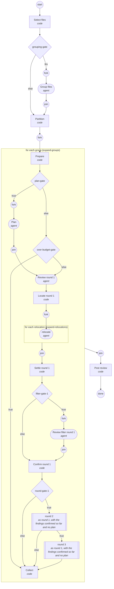

# code-review-ocr

[Alibaba OpenCodeReview](https://github.com/alibaba/open-code-review) (OCR, `ocr review`) as a
protocol: the same review pipeline, prompts, rules and tools, run the factory's way. OCR's
deterministic steps (file selection, rule matching, grouping thresholds, comment placement,
the review's rendering) are code nodes ported from its Go code; its LLM steps (grouping,
planning, the review rounds, the review filter, re-location) are agent nodes that answer
OCR's own conversations, rendered word for word. It posts the review as OCR's GitHub Action
does: inline comments under one sticky summary comment.

**Engine floor:** `min_engine_version` 21.1.0 · **Upstream:** alibaba/open-code-review
`d4f568f` (v1.14.4), vendored under its Apache-2.0 license
([`workflows/ocr/upstream/UPSTREAM.md`](workflows/ocr/upstream/UPSTREAM.md))

**Status.** The deterministic half is tested against upstream's own functions (below) and
cross-checked with the real `ocr` binary (`ocr delegate preview` / `rule`: the same files
selected, the same exclusions and the same rule text). On the test stack (GitLab):

- the `two-rounds` scenario passes: every node real but the agents' answers, run twice on
  one MR (the summary is edited in place, each run posts its review);
- with every agent on the real model (codex): a one-file MR ran end to end (plan, two
  rounds, the filters; two findings posted), and a four-file MR ran grouping into three
  groups reviewed side by side, their plans, rounds and filters, and posted five findings
  (with units that still read their conversation in one `cat`, which an agent CLI
  truncates; the current units, reading it in parts, ran every agent node of the same MR
  again, until the test host could no longer start job VMs).
  Re-location ran with authored evidence only: the model's quotes always matched.
- Every leg publishes a commit status; a leg whose first attempt failed kept a `failed`
  status after its retry succeeded (the run's own status stayed green).

The agent units compile with gh-aw v0.89.0.

## Shape

Rounded boxes are agent nodes, boxes code nodes, diamonds `choice` nodes; each pair of
circles is a fork and its join. A tolerant fork (below) wraps a step that may fail.
Rounds 2 and 3 are drawn folded: each repeats round 1's steps. `tests/generate/gen_diagram.py
--readme` draws it from `protocol.json`.

<!-- protocol-diagram:start -->

<!-- protocol-diagram:end -->

## How it works

| Upstream (`ocr review --from <base> --to <head>`) | Here |
|---|---|
| Diff load: the root `.gitignore`, the provider's directory list | `select` (code, checkout) |
| `selectFiles`: binary, secret paths, the user's include/exclude, the extension allowlist, the default exclude patterns, deletions, the per-file size gate | `select` |
| `groupDiffs`: ≤1 file or under `GROUPING_MIN_FILES` → no LLM (bundle or per file); else the `GROUPING_TASK` call | `grouping-gate` (choice) → `grouping` (agent) |
| `parseGroupingResponse`, 10 files a group, the token budget split, a failed call → one group per file | `partition` (code) |
| One sub-agent per group, concurrently | `review` (dynamic fork, one leg a group) |
| `resolveGroupSystemRule`, `PlanRequired`, `--effort`, the round-1 prompt budget | `prepare` (code, checkout) → `plan-gate`, `over-budget-gate` |
| `PLAN_TASK` (one call, tools described, not callable); a failure → no plan | `plan` (agent) in a tolerant fork |
| `MAIN_TASK` round 1, with the plan | `review-1` (agent) |
| Each `code_comment`: `ResolveComment`, `RelocateAcrossFiles`, then `RE_LOCATION_TASK` | `locate-<n>` (code) → `relocate-<n>` (dynamic fork, one agent leg a comment) → `settle-<n>` (code) |
| `REVIEW_FILTER_TASK` over the round's comments on the group's files; a failure removes none | `filter-gate-<n>` → `filter-<n>` (agent) in a tolerant fork |
| Round end: newly confirmed findings, stop on none new, 30 confirmed, or no rounds left | `confirm-<n>` (code) → `round-gate-<n>` |
| Rounds 2 and 3, without the plan, with the confirmed findings; a failure keeps the earlier rounds | `review-2`, `review-3` (agents) in tolerant forks, unrolled |
| The run manifest's coverage and exit policy; the CLI's output pass (`ResolveLineNumbers`); the Action's poster | `post` (code, checkout) |

As upstream, a review whose files all failed, or that failed for anything but a budget
(a group whose round-1 review agent failed or answered `task_done` `FAILED`), is one
`ocr review` exits nonzero on: the Action then posts nothing and fails the job, and `post`
posts nothing and concludes `failure`. A later round that fails keeps what the group already
found and warns `review_round_failed`; a group over the round-1 prompt budget fails its
files as a budget stop, which still posts ("Review partially complete: …").

A *tolerant fork* is a fork of one leg whose join takes `quorum:0%`: the leg's failure does
not fail the group, and the next code node finds no input from it and falls back, as
upstream logs the failure and goes on.

Every agent's prompt is OCR's: a step of its job (`agent_prompt.py`) fills the vendored
prompts from the node's inputs and the run's MR snapshot exactly as upstream fills them,
into `/tmp/gh-aw/agent/ocr-prompt.md`; the unit's body tells the agent to read it and how
OCR's tools map here. The review agent calls OCR's four context tools (`code_search`,
`file_read`, `file_read_diff`, `file_find`, with the range review's `side`) as
`ocr_tools.py`, which returns what upstream's tools return; its `code_comment` calls and
`task_done` become its final answer, the node's evidence.

## Inputs

| Input | Default | Upstream |
|---|---|---|
| `effort` | `medium` | `--effort` (`low` · `medium` · `high`: 1, 2, 3 rounds) |
| `language` | `English` | the Action's `language` |
| `background` | `""` | `--background` |
| `rule` | `""` | `--rule` (a rule.json path in the repository) |
| `no_filter` | `false` | `--no-filter` |

A repository's own `.opencodereview/rule.json` applies as upstream applies it.

## Triggers

- `pull_request` `opened` · `reopened` (upstream's `pull_request_target`)
- `/open-code-review` comment (`issue_comment`, command `start`)

Upstream also reviews every push (`synchronize`). Here a push needs a
`/open-code-review` comment: on GitLab the factory reads every merge-request update
as `synchronize`, the status writes of the run itself included, so a `synchronize`
trigger would restart the review without end.

## Units

- agents: `workflows/{grouping,plan,review,filter,relocate}-agent.md`
- code: `workflows/{select,partition,prepare,locate,settle,confirm,collect,post-review}.yml`,
  each running the `.py` beside it; the port in `workflows/ocr/`, upstream's data in
  `workflows/ocr/upstream/`
- expanders: `expand/expand-groups`, `expand/expand-relocations` (they hand on a code node's list)

## Agent slot

All five agent units import `shared/agent.md`, the protocol's one agent slot (see the
top-level README, "Agent slots"). The review agent needs a strong coding model and a
shell with `python3` and `git`.

```bash
cp <your profile>.md <path-to-this-protocol>/workflows/shared/agent.md
gh aw compile --dir <path-to-this-protocol>/workflows
```

## Install

Copy this directory to `<your-repo>/.softwarefactory/protocols/code-review-ocr/`, fill the
slot, compile, and commit.

## Tests

- `tests/test_upstream_parity.py`, `tests/test_tools_parity.py`: the port against upstream's
  own Go functions, which an oracle ran on `tests/golden/cases.json` (a real change set:
  renames, deletions, a binary, a mode change, CRLF, quoted non-ASCII paths); the
  answers are `tests/golden/upstream_*.json`. Diff parsing, comment placement and
  re-filing, `.gitignore`, the path gates, every rule layer, selection, grouping, the round
  thresholds, every rendered prompt, the tool definitions and the four tools' answers
  are byte-identical.
- `tests/test_nodes.py`: one MR through every code node, the prompt rendering and the
  poster; `tests/test_scenario_offline.py`: the `two-rounds` scenario's evidence played
  through the code nodes.
- `scenarios/two-rounds/`: the same MR walked on the test stack.

## Where it differs from upstream

Agents are agent CLIs, not OCR's own chat loop:

- The review loop is the agent CLI's: there is no `MAX_TOOL_REQUEST_TIMES` (100) cap, no
  three-empty-rounds stop, and no `MEMORY_COMPRESSION_TASK`; the CLI manages its own
  context, and the node's timeout bounds the round.
- The comments are the round's final answer: a round whose agent dies without
  answering loses the comments it found (upstream keeps every `code_comment` already
  filed). An answer with `task_done` `FAILED` keeps them, as upstream.
- Grouping, the plan, the filter and re-location are one request each upstream, with no
  tools. Here the agent is told to read the prompt file and nothing else; the shell it
  has is not taken away (codex cannot restrict its commands).
- The filter's tool call is its answer's `tool`, `analysis` and `comment_ids` fields.
- The conversation reaches the agent as a file it reads, in parts of at most 6000 bytes
  (an agent CLI truncates a long command output), and the review's tool definitions as
  one file per tool; upstream sends them as the request's messages and `tools`.

The factory runs them differently:

- Each LLM call is a job: one VM per agent node, one per re-located comment.
- Tokens are estimated at four bytes a token (upstream counts cl100k): the per-file
  size gate, the group token split and the round-1 prompt budget decide on the estimate.
- A group over the round-1 prompt budget skips its plan (upstream plans, then stops).
- A review has at most 256 groups (a fork's leg cap); the files of any further group
  are named in the summary's warnings and counted as failed by a budget, unreviewed.
- The run's timestamp is UTC.
- The review's `side: old` tools read the comparison base when the agent's checkout
  holds it (gh-aw fetches the MR's commits and one more: normally the base).
- Every leg publishes a check-run; upstream is one CI job.

Not ported:

- Upstream's other modes (`ocr scan`, workspace and commit reviews, delegation mode,
  `--analysis`), `--max-tokens-budget`, resume, sessions and the viewer, telemetry, MCP
  tools, and the user's `~/.opencodereview/rule.json`.
- The Action's options that are off by default: incremental posting, severity and
  category routing, resolving outdated threads, checkpoint ranges, artifact upload.
  The sticky summary is found by its marker alone.
- The `@open-code-review` comment trigger, and the review on every push (see Triggers);
  who may start a run is the factory's rule.

## The engine constructs it works around

- **No non-interrupting error boundary on a node in a leg**: a failed agent node fails
  its whole leg. The tolerant forks above give upstream's "log and go on".
- **A round cannot be a loop**: a `choice` can route back, but a dynamic fork entered
  again reuses the legs it recorded the first time (its cardinality is frozen for the
  run), so a looped round's re-location fork would not see that round's comments. The
  rounds are unrolled (at most three, `--effort high`), each reading the previous
  round's `confirm`; `tests/generate/gen_protocol.py` writes them.
- **The agent's prompt is fixed before its steps run** (gh-aw builds it in the activation
  job): the rendered conversation is a file the agent reads, not its prompt.
